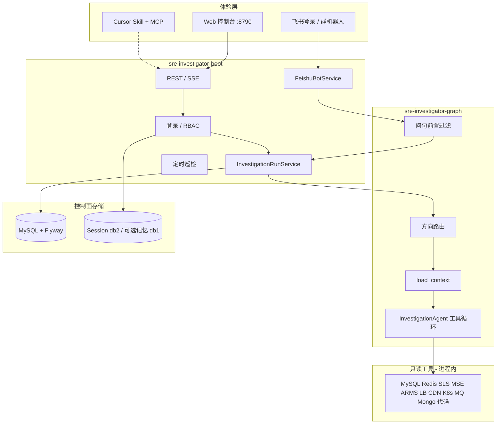

# SRE Investigator

面向多微服务、多仓（前后台）分布式项目线上故障场景的**只读排查控制面**：按项目和环境隔离、全程可审计的智能排查 Agent 平台。Web 控制台、飞书群机器人、Cursor MCP 三入口共用同一套编排——问句先过滤无效流量，再按 INVESTIGATE / REVIEW / ASK 分流；排查走循环 Graph（`route → load_context → investigate ⇄ decide → synthesize`），按环境装载 Skill / Rule / 工具 Binding，模型在预算内调用只读工具取证，输出「现象—证据—已排除项—根因假设—下一步」的可复核报告。

**不做**：写库、清缓存、改配置、重启、发布、回滚。工具面没有写命令，生产凭据不进 Git、不进前端。

## 核心能力

- **智能编排**：问句前置过滤、意图分流、循环 Graph 工具循环、Skill 按场景动态装载；支持 DashScope / OpenAI 兼容 / Anthropic / Ollama 多模型供应商。
- **实例监控**：工具绑定级旁路监控，覆盖 MySQL / Redis / Elasticsearch / MongoDB——连接数、CPU/内存占用率、QPS/OPS、缓存命中率、磁盘/分片/集群健康、慢 SQL 明细（表格分页、按耗时倒排）；60 秒定时只读采集落库，指标趋势可回溯；全部经只读守卫采集，不进入 Agent 排查链路，独立权限控制开关与查看。
- **三层记忆**：会话级工作记忆（近几轮对话 + 摘要）支撑多轮追问；项目级长期记忆（环境拓扑、Binding、历史 Run 结论）跨会话召回；平台级经验记忆（典型案例沉淀为 Skill / Rule，可选 Qdrant 向量检索）让排查越用越准。
- **协作入口**：飞书群 @机器人发起排查或分支审查，按发送人隔离会话；Cursor 经 MCP + Skill 复用同一套工具协议。
- **只读工具面**：代码检索、MySQL / Redis / MongoDB / Elasticsearch、SLS、MSE、ARMS、负载均衡 / CDN、K8s（只读）、StarRocks、Kafka / RocketMQ。
- **安全底座**：RBAC 权限模型、AES-GCM 加密凭据、全量审计留痕、按项目/环境的工具授权隔离。

| 你想… | 看这里 |
|---|---|
| 技术栈、架构、推荐怎么启动 | 下文 |
| 本机 IDEA / Docker 逐步操作 | [docs/local-setup.md](docs/local-setup.md) |
| Profile、配置文件、两类库 | [docs/config-profiles.md](docs/config-profiles.md) |
| 接入一个业务项目 | [docs/onboarding-project.md](docs/onboarding-project.md) |
| 飞书登录 / 群机器人 | [docs/feishu-group.md](docs/feishu-group.md) |
| ARMS / 负载均衡 / CDN 的 RAM AK | [docs/aliyun-readonly-ram.md](docs/aliyun-readonly-ram.md) |
| 对话编排细节 | [docs/explain/orchestration.md](docs/explain/orchestration.md) |

登录页默认超管：`admin` / `admin123456`（仅本地；上线前改掉）。控制台 http://localhost:8790/

---

## 技术栈

日常排查跑在**一个 JVM 进程**里：控制台静态资源打进 Boot，只读工具是进程内适配器，不另起 MCP 子进程。Cursor 用的 Node MCP 是可选旁路。

| 层 | 选型 | 说明 |
|---|---|---|
| 运行时 | Java 17（禁止 Preview / 18+） | Maven 多模块，入口 `InvestigatorApplication` |
| 后端 | Spring Boot **3.4.5** | Web、Validation、Security |
| 会话 | Spring Session + Redis | Cookie `INVESTIGATOR_SESSION`，Redis db **2** |
| 控制面库 | MySQL 8 + Flyway + Hibernate `validate` | 库名 `sre_investigator`；表由 Flyway 管，Hibernate 不建表 |
| 编排 | Spring AI **1.0.0** + Spring AI Alibaba Graph **1.0.0.2** | `route → load_context → investigate ⇄ decide → synthesize` |
| 模型 | DashScope / OpenAI 兼容 / Anthropic / Ollama | 控制台「模型」页或 gitignore 的 `application-model.yml` |
| 前端 | React 18 + Vite 6 + TypeScript | `apps/console`，`pnpm build` 输出到 Boot 的 `static/` |
| 工具调用 | 进程内 `FunctionToolCallback` | 阿里云走 HMAC 签名 HTTP，不引入官方 SDK |
| 可选记忆 | Redis db **1**、Qdrant | 默认关；挂了才用，挂掉回退 |
| 可选 Cursor | `packages/mcp-templates`（Node stdio MCP） | 给 IDE 用；排查主路径不依赖它 |


---

## 架构

### 定位

| 层 | 做什么 | 不做什么 |
|---|---|---|
| 体验 | 控制台、飞书 `@机器人`、Cursor MCP | 不在客户端存生产凭据 |
| 控制面 | 项目 / 仓 / Binding / RBAC / 会话 / 审计 / 用量 / 定时 | 不直连业务写库 |
| 编排 | 问句过滤 → 方向路由 → 装载 Skill/Rule → 工具循环 | 不自动修复、不执行变更 |
| 工具 | 代码、MySQL、Redis、SLS、MSE、ARMS、ALB/CLB、CDN、K8s、StarRocks、Kafka、RocketMQ、Mongo 只读 | 不注册写命令、不 `KEYS`、MySQL 不跨 schema |

### 模块怎么拆



| 模块 | 职责 |
|---|---|
| `apps/console` | React 控制台；构建结果进 Boot 静态资源 |
| `sre-investigator-api` | 请求 DTO、环境、连通性测试入参 |
| `sre-investigator-domain` | 项目、Run、Binding、用户、权限等端口 |
| `sre-investigator-infra` | JPA、Flyway、AES-GCM、审计 |
| `sre-investigator-graph` | 过滤、路由、Skill、Agent Graph |
| `sre-investigator-mcp-servers` | 进程内只读适配器（名字是历史原因，**不是**独立 MCP Server） |
| `sre-investigator-boot` | 进程入口、REST/SSE、飞书、定时任务、静态页 |
| `packages/mcp-templates` | Cursor 可拉起的 Node 只读 MCP（可选） |
| `sre-investigator-console` | 历史占位模块，不要当控制台源码 |

控制台菜单：项目、代码仓、工具 Binding、领域专家、飞书群、定时、对话、代码审查、模型、用户、角色、审计、用量。

### 一次排查怎么走

1. 入口：控制台对话 / 代码审查，或飞书群 `@机器人`。
2. **前置过滤**：寒暄、夸奖、无故障试探不跑工具；有用户号 / 5xx / 订单等信号才放行。
3. 会话改写问题（最近 2 轮 + 摘要），再按模式分流：
   - **INVESTIGATE**：`route → load_context → investigate ⇄ decide → synthesize`。工具 = 当前环境已启用 Binding ∩ 方向白名单（问句关键词只加种类）。`http-5xx` 会带代码 / 日志 / MSE / ARMS / 负载均衡 / MySQL / K8s；CDN 只在域名、静态资源、回源等信号出现时才开。
   - **REVIEW**：对比 `base..head`，装审查 Skill / Rule。
   - **ASK**：只读代码，不装业务库工具。
4. 点名「使用 xxx mcp」时本轮只留那一个 Binding。
5. 报告、工具摘要、用量写入控制面 MySQL，可审计。审计不写 AK、不写完整 trace。

凭据分两层：

- **控制面自己**：本机 `application-local.yml` 的 MySQL / Redis；AES 主密钥、飞书、模型 Key 写 gitignore 的 `application-secrets.yml` / `application-model.yml`。
- **排查目标**：绝大多数 Binding 在工具页各自保存（加密）。**ARMS / ALB·CLB / CDN 例外**：共用进程级 RAM 只读 AK（环境变量或 secrets 文件），Binding 只存地域和开放的应用 / 实例 / 域名。

---

## 启动方式（怎么选）

两种合法跑法，**不要同时占 8790**，也不要把 Docker 的 MySQL（宿主机 **33069**）和 IDEA 默认的本机 **3306** 当成同一个库。

| 场景 | 用这个 | 不要用那个 |
|---|---|---|
| **改 Java / 日常开发（推荐）** | 本机 MySQL `3306` + Redis `6379` + IDEA Debug | 不要再 `docker` 起 `app` 容器 |
| **只看页面、验收、给别人演示** | `./scripts/dev.sh docker` | 不要同时 Debug 本机 Java |
| 改控制台 UI | IDEA 已在跑时：`pnpm --filter @sre-investigator/console dev`（:5173 代理到 8790），或 build 后再重启 Java | 不要只改 `apps/console` 却期望已打包的 static 自动变 |

### 1. 推荐：IDEA Debug（开发）

依赖：JDK 17、本机 MySQL `127.0.0.1:3306`（默认 `root` / `123456`）、Redis `127.0.0.1:6379`。

1. IDEA Open 仓库根 `pom.xml`。
2. 空库二选一，**不要混着跑**：
   - 推荐：`mysql -h127.0.0.1 -P3306 -uroot -p123456 < docs/sql/sre_investigator_init.sql`（对齐 Flyway V25）
   - 或者什么都不导，直接启动，Flyway 跑 `V1`～`V25`
3. Debug `sre-investigator-boot` → `InvestigatorApplication`。**Active profiles 留空** = `local`（自动带 `mysql` + `tools`）。
4. 打开 http://localhost:8790/

密钥不要改已提交的 yml，本地自建（均已 gitignore）：

| 文件 | 写什么 |
|---|---|
| `application-secrets.yml` | `investigator.secrets.master-key`（AES）、飞书、可选 `investigator.aliyun` |
| `application-model.yml` | DashScope / OpenAI 等模型 Key |
| 环境变量 `ALIBABA_CLOUD_ACCESS_KEY_ID` / `SECRET` | ARMS / 负载均衡 / CDN 全局 RAM 只读 AK |

改完 Java 或 secrets **必须重启 Debug**。逐步排错见 [docs/local-setup.md](docs/local-setup.md)。

### 2. 一键看页面：Docker

```bash
cd sre-investigator
cp .env.example .env    # 可改超管口令、模型 Key；MASTER_KEY 留空则脚本会生成
./scripts/dev.sh docker
```

容器内 profile 是 `local,docker`。页面同样是 http://localhost:8790/ 。停：`./scripts/dev.sh docker-down`（数据卷保留）。

只要库、Java 仍用 IDEA 时：

```bash
docker compose -f deploy/docker-compose.yml up -d mysql redis
```

注意：Compose 里 MySQL 映射是 **33069**，和 `application-local.yml` 的 **3306** 不是同一处。IDEA 默认连本机 3306；只有改了 JDBC 才去连 33069。

### 3. 不推荐当日常的

- `./scripts/dev.sh start`：本机 Maven 前台起 Java，日志在终端，改代码仍要停启，不如 IDEA Debug。
- 只开 `tools`、不开 `mysql`：控制面走内存仓，刷新页面项目是空的。
- `memory` profile：零依赖演示，**不要**和 `local` / `test` 一起开。

---

## 还没做 / 规划

已经具备：RBAC、飞书、代码审查、Skill/Rule、SLS / MSE / ARMS / 负载均衡 / CDN / K8s 只读、定时巡检、领域专家编排、用量与审计。下一阶段仍不碰自动修复。

| 优先级 | 方向 |
|---|---|
| 近 | 提示词分层（System 放政策，User 放 Brief / `@` 预读）；Binding 密钥统一解析并接入 KMS/Vault；脱敏故障评测集 |
| 中 | ES 只读；token 级 SSE / 取消；告警进草稿再确认排查 |
| 远 | 多 Agent 分工；审批式执行面（若要修复，走独立通道，不进只读工具） |

更早的讨论稿：[docs/plans/sre-investigator-architecture-and-roadmap.md](docs/plans/sre-investigator-architecture-and-roadmap.md)（部分段落已落后，**以本 README 为准**）。
